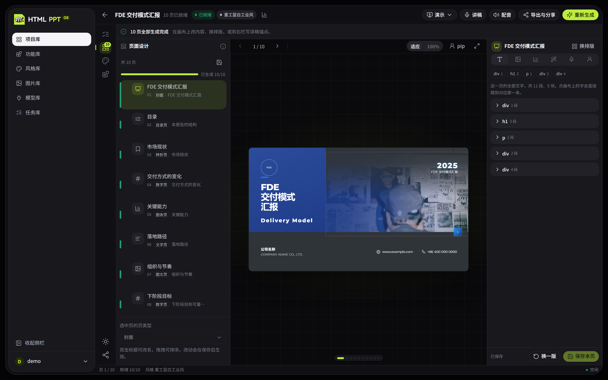
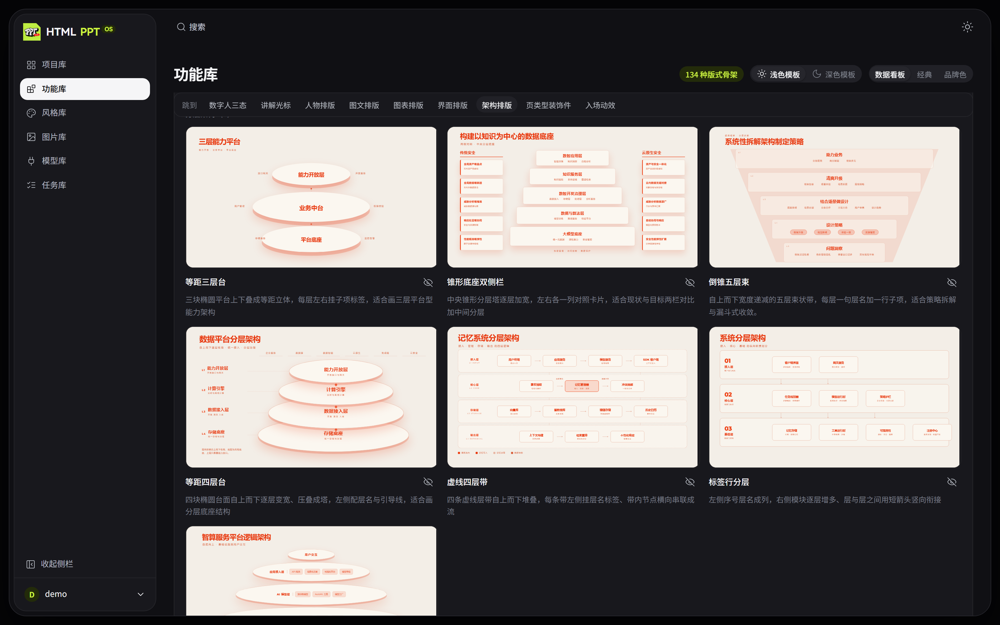

# HTML PPT OS

从想法到讲解一步到位的演示平台。

一句话说清它做什么：以前要先把内容做成 PPT、再找人讲；现在给一段内容或一个想法，选一种风格，它逐页生成可翻页、可精修、可导出、可分享的演示稿，并配好讲稿与语音讲解。



---

## 为什么做这个

现成的 AI 做 PPT 工具，绝大多数给你的是一个**一次性产物**：生成完、下载走，想改只能回去重来。而真实的演示是有后续的——要改一页措辞、换一套风格、补一张图、加一段讲解，明天还要拿去讲。

所以这个项目把重心放在**生成之后**：

- **生成是逐页落地的**。大纲 30 页，第一页出来就能翻、能改，不用等整本跑完（页级生成是本地规则计算，毫秒级，不依赖后台 worker 是否在跑）。
- **改的不是"重新生成一遍"**。文字、图片、数据、讲稿、数字人各自有面板，改完存回这一页的 HTML；模型重排的版式与你的修改互不覆盖。
- **版式和风格是两件事**。一套风格决定气质（配色、字体、语法），一份版式决定这一页怎么排。换版式不动风格，换风格不动内容——所以「换个说法再讲一遍」只要几十秒。
- **本地自包含**。SQLite + 对象存储落在自己机器上，不接模型 Key 也能用内置 Mock 把全链路跑通（它是一等实现，不是桩）。想接真实模型在管理后台点几下就行，不用改代码。

适合的场景：你手上有内容（一份方案、一份调研、一门课），需要一个能反复打磨、最后能讲出来的东西。

---

## 界面

**编辑器**：左栏大纲（拖拽排序 / 页类型 / 生成状态），中栏画布（等比缩放、键盘翻页），右栏六个面板（文字 / 图片 / 数据 / 动效 / 讲稿 / 数字人）。生成是逐页落地的——第一页出来就能改，不用等整本跑完。

**风格库**：一套风格 = 每种页类型一条生成提示词，加它跑出来的样机。配色、字体、排版语法、动效白名单都封在风格里，所以换风格不会动到内容。下面这些缩略图就是每套风格现场渲染出来的。


**功能库**：跨页类型复用的零件都在这里，全部由真实生成链路现场渲染，不是截图。版式骨架 134 种，分人物 / 图文 / 图表 / 界面 / 架构五类——


架构排版（分层 / 矩阵 / 辐射 / 流程 / 框架五组，平面与等距立体都有）：



---

## 快速开始

```bash
pnpm install
pnpm seed          # 迁移 + 内置管理员/Mock 网关/默认路由 + 演示项目
pnpm dev           # 一条命令拉起 api + web + admin + worker
```

打开：

| 入口 | 地址 | 说明 |
| --- | --- | --- |
| 工作台 | http://localhost:5273 | 项目库、三栏编辑器、演示模式 |
| 管理后台 | http://localhost:5274/admin/ | 仅 admin 可登录 |
| API | http://localhost:8787 | `/api/health` 可用于探活 |

账号：

- 管理员 `admin / admin`，开发环境直接可登。生产环境（`NODE_ENV=production`）默认要求首次登录改密，可用 `LUMEN_ADMIN_FORCE_PASSWORD_CHANGE` 覆盖。
- 演示账号 `demo / demo1234`（由 `pnpm seed` 创建）

**忘了管理员密码、或被登录失败锁住**：跑 `pnpm admin:reset` 恢复成 `admin / admin`。这是本地运维通道，不受密码策略限制——能在这台机器上跑脚本的人本来就能直接改库，在这里卡「密码必须含数字」只会把人锁在自己的默认密码外面。远程接口仍然一律走密码策略。

> 无模型 Key 也能把全链路跑通：内置 Mock 网关会返回确定性的占位内容。接入真实模型见下文「接入真实模型」。

### 其他命令

```bash
pnpm typecheck     # 全仓类型检查
pnpm test          # 全仓单元与集成测试
pnpm build         # emoji lint + 类型检查 + web/admin 生产构建
pnpm lint:emoji    # 只跑 emoji 拦截
pnpm smoke         # 端到端冒烟（需先启动服务）
pnpm db:migrate    # 只跑数据库迁移
pnpm admin:show    # 查看内置管理员状态
pnpm admin:reset   # 重设管理员密码为 admin（本地运维通道）
```

`pnpm smoke` 默认只验证 PPTX 导出（最快，且已覆盖「无头渲染 → 对象存储 → 下载」全链路）。要全量验证四种导出格式：

```bash
LUMEN_SMOKE_FORMATS=pptx,pdf,html,pptx-editable pnpm smoke
```

---

## 目录结构

```
apps/
  api/           HTTP 接口（Express 5），含 admin 分区
  web/           主应用：项目库、工作台、演示模式
  admin/         管理后台（CRM、Provider、路由、审核、监控、审计、用量、设置）
  worker/        队列消费者：图片、讲稿、语音、导出
packages/
  ir-schema/     全部契约（Zod）。Page IR、Style Pack、Task、User、Export…
  content-engine/  内容 → 大纲 → Page IR（纯规则，毫秒级）
  style-engine/  5 个内置风格系列、21 个规范变体、风格抽取与识别
  render-engine/ 版式解析、溢出适配、设计 Lint
  slides/        React 渲染引擎（同一套代码驱动全部变体）
  ui/            设计系统组件（Radix + Tailwind v4）
  design-system/ 设计令牌与主题
  charts/ motion/ 图表与动效封装
  provider-gateway/ OpenAI 兼容协议 + 确定性 Mock
  task-client/   基于 DB 租约的队列（幂等、心跳、按组并发、DLQ）
  server-core/   api 与 worker 共用的业务层（唯一真源）
  storage/ tts/  本地对象存储、语音合成
scripts/
  dev.mjs seed.mjs smoke.mjs lint-emoji.mjs
docs/
  superpowers/specs/  技术设计（工程决策与理由）
  superpowers/plans/  实施计划
  验收清单.md          对照 PRD 的验收结果与能力边界
```

**关键取舍**：`server-core` 同时被 api 与 worker 引用，业务逻辑只写一遍。队列语义、降级规则、配额口径在两个进程里必然一致。

---

## 主要能力

**生成链路**：内容 → 意图识别 → 大纲 → 逐页 Page IR → 版式匹配 → 溢出适配 → 设计 Lint → 渲染。页级生成是本地规则计算（毫秒级），在 API 内联执行并即时推送，因此**逐页落地是真实的**：已生成的页立刻可翻页、可编辑，不依赖 worker 是否在跑。图片、语音、导出这类慢任务才入队。

**风格体系**：5 个内置系列（商务经典 / 学术严谨 / 科技极简 / 品牌设计 / 亲和精品），每个系列实现同一组 21 个规范变体，只在容量画像上不同。风格包是 5 层结构（基础令牌 / 版式容量 / 标题语法 / 动效白名单 / 组件样式），渲染层不做任何视觉决策。

**溢出策略**（按序，不跳级）：换 variant → 重排块 → 降字号（字阶内 1–2 档）→ 拆页（标题标「（续）」）→ 摘要（原文存 `overrides` 可回溯）。

**编辑器**：三栏。左栏大纲（拖拽排序、风格选择、意图编辑），中栏画布（等比缩放、键盘翻页、全屏），右栏六个面板（文字 / 图片 / 数据 / 动效 / 讲稿 / 数字人）。

**演示与分享**：全屏演示、键盘与触摸翻页、浏览器 TTS 朗读、讲稿驱动的内容高亮与光标锚点。分享链接带签名与有效期，访客只读，撤销后立即失效。

**导出**：PDF、PPTX（截图版，视觉 100% 还原）、PPTX（可编辑实验版）、HTML（单文件自包含，可离线或微信内置浏览器打开）。

**管理后台**：用户与 CRM（含配额、重置密码、强制下线、CSV 导出）、用量与计费、Provider 配置与连通性自检、任务路由（锁定路由需显式解锁）、风格库审核、跨租户任务监控与死信重试、审计日志、全局设置。

---

## 接入真实模型

无需改代码，走管理后台：

1. 管理后台 → **Provider 配置** → 新增，填 Base URL、API Key、模型名（文本/图片各一组），保存后用「测试连接」验证
2. 管理后台 → **任务路由** → 把对应环节的主模型切到新 Provider

`html_codegen` 与 `image` 两条路由默认锁定，需在界面上先解锁再改，避免生成结果的版式与画风随模型漂移。

内置 Mock 网关不发任何外部请求，返回确定性占位内容，用于无 Key 时跑通全链路。它是一等实现，不是桩。

---

## 配置

所有变量都有开发默认值，只有 `LUMEN_SECRET_KEY` 在生产必填。复制 `.env.example` 为 `.env.local` 后按需修改。

| 变量 | 默认 | 说明 |
| --- | --- | --- |
| `LUMEN_PORT` | `8787` | API 端口 |
| `LUMEN_WEB_PORT` / `LUMEN_ADMIN_PORT` | `5273` / `5274` | 前端端口 |
| `LUMEN_SECRET_KEY` | 开发自动生成 | 主密钥：API Key 加密 + JWT 签名。生产必填，≥32 字符 |
| `LUMEN_ADMIN_PASSWORD` | `admin` | 内置管理员初始密码（仅首次创建时生效，改密码用 `pnpm admin:reset`） |
| `LUMEN_ADMIN_FORCE_PASSWORD_CHANGE` | 留空 | 首次登录是否强制改密。留空 = 生产强制、开发不强制 |
| `LUMEN_ALLOW_SELF_SIGNUP` | `true` | 是否开放自助注册 |
| `LUMEN_DATA_DIR` | `./data` | 数据根目录（SQLite + 对象存储） |
| `LUMEN_MAX_CONCURRENCY` | `6` | 全局任务并发上限 |
| `LUMEN_QUEUE_LEASE_MS` | `60000` | 任务租约时长 |
| `LUMEN_PUBLIC_BASE_URL` | `http://localhost:8787` | 对外基址（分享链接、导出回链） |
| `LUMEN_TTS_ENGINE` | 空 | 设为 `mock` 则跳过 Edge 直接走本地合成 |

数据全部落在 `LUMEN_DATA_DIR`：`lumen.db`（SQLite，WAL）与 `objects/`（按 `{tenantId}/{projectId}/` 分区）。

---

## 安全与隔离

- 访问令牌只存内存，刷新令牌走 httpOnly cookie；401 自动刷新一次后重放
- 密码 scrypt 哈希；Provider 的 API Key 用 AES-256-GCM 加密落库，接口只回传掩码，审计只记录改了哪些字段
- 所有数据访问强制带 `tenantId`；越权返回 403 并写审计
- admin 分区双重隔离：前端路由守卫 + 后端 `requireAdmin` + 审计留痕
- 登录失败 5 次锁定 15 分钟；自助注册同 IP 每小时限流

---

## 质量基线

- **界面零 emoji**：`scripts/lint-emoji.mjs` 在构建期扫描代码点，命中即构建失败
- 统一线性图标（Lucide，线宽 1.5，尺寸仅 16/20/24），纯图标按钮必须有 `aria-label`
- 主色 `#6D4AFF`，强调色 `#FF7A1A`，明暗双主题
- 正文字号不低于 12px，投影场景下不塌版

---

## 已知边界

如实记录当前版本没做到的部分，避免误判：

- **MP4 视频导出未实现**。`video_render` 与 `avatar_render` 是明确抛错的占位 handler，不会静默产出半成品。导出面板里 MP4 已置灰。
- **Edge TTS 是非官方协议**，微软随时可能改动握手头与鉴权参数。失败时自动降级为本地合成并写入降级原因，任务中心可见。若要稳定的语音，建议在 `packages/tts` 下接一个正式的服务商适配器。
- **PPTX 可编辑版是实验性质**。重建标题/正文/指标/图片，可编辑但还原有损，复杂装饰会降级为背景图。
- **PDF / PPTX 依赖 Playwright 无头渲染**，首次运行需下载 Chromium。
- 端到端自动化覆盖到生成、导出 PPTX、分享与撤销（见 `pnpm smoke`）；PDF 与可编辑 PPTX 的产物仅单独验证过渲染器，没有走完整 HTTP 链路的自动化覆盖。

---

## 技术栈

Node 24（`node:sqlite` 内置，零原生依赖）· TypeScript NodeNext · pnpm workspaces · Express 5 · React 19 · Vite 6 · Tailwind v4 · Radix UI · TanStack Query · zustand · Playwright · PptxGenJS · Zod

设计文档见 `docs/superpowers/specs/2026-10-19-lumen-deck-design.md`，验收结果见 `docs/验收清单.md`。

---

## 作者

**baijuyiai** · https://github.com/baijuyiai

这个仓库是内部开发仓库定期发布的**公开快照**（不含内部数据），所以提交历史从发布点开始。问题、想法、想加的功能都可以开 Issue 说。

## 贡献

欢迎提 Issue 与 PR。开工前先说一句的两件事：

- **界面里不许有 emoji**，`pnpm lint:emoji` 会在构建期拦住（这条是有意的，别绕过）。
- 改动请带上测试。`pnpm test` 是全仓的，跑一遍只要十几秒。

## 许可证

[MIT](LICENSE) © 2026 baijuyiai

用、改、商用、闭源再分发都可以，保留许可证文件即可。

